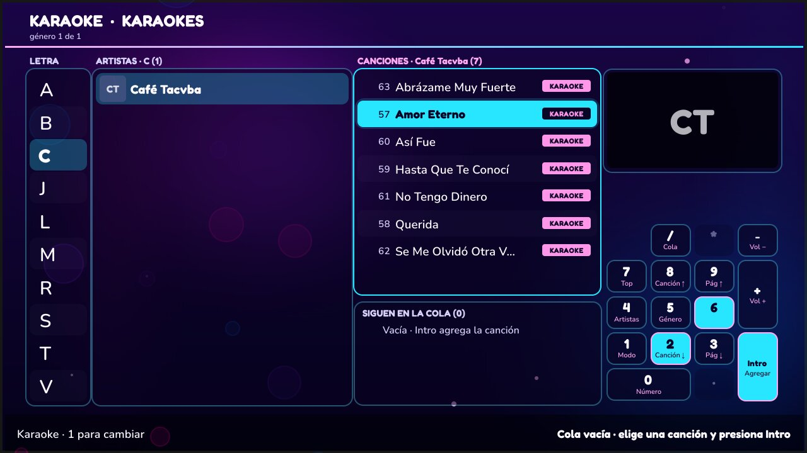
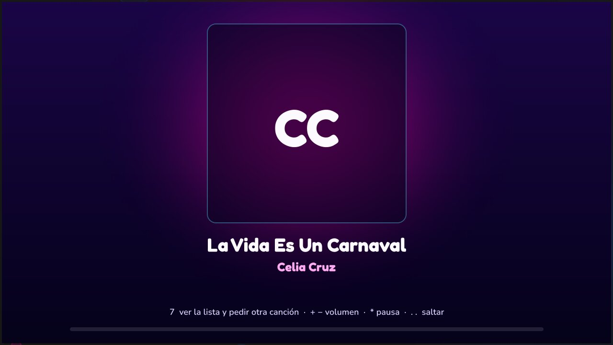
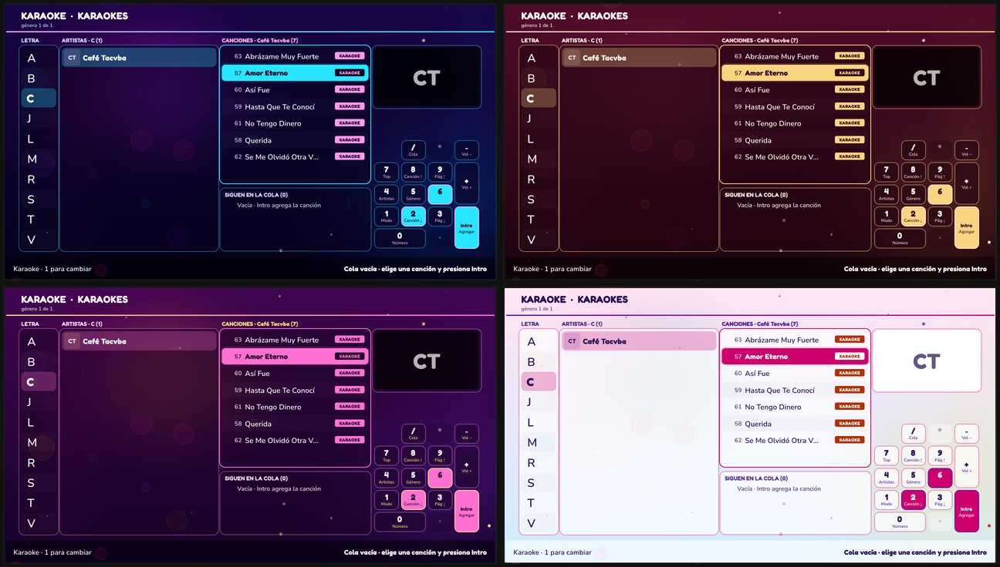
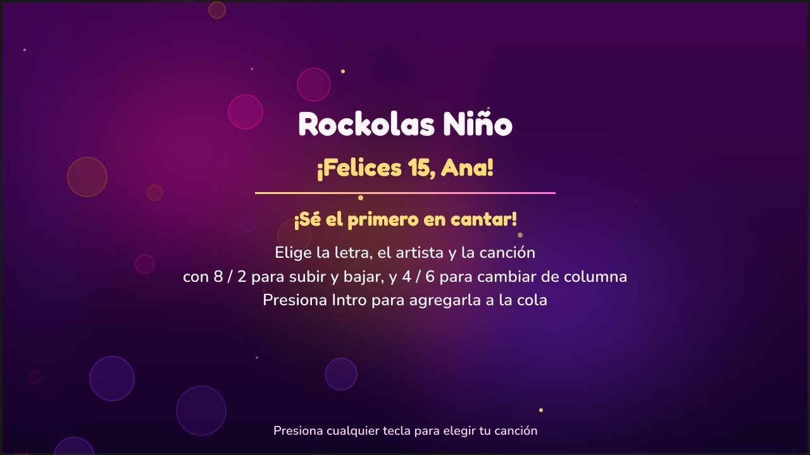

# KaraokeNino

Rockola de **karaoke y música sin internet** para rentar en fiestas. Corre en
**Debian / Puppy Linux** con 2 GB de RAM, se maneja con el **teclado numérico**
y arranca sola en pantalla completa al encender la computadora.

- **Go + Fyne**: ventana nativa que se adapta a cualquier TV (4:3 o 16:9, 720p o 1080p).
- **mpv**: reproduce todo el catálogo (AVI, MPG, MP4, WMV, MP3, WMA, CDG+MP3…), con volumen normalizado.
- **SQLite**: 166 mil canciones con búsqueda instantánea; cada canción tiene un **número fijo** para pedirla.
- **Temas de fiesta**: moderno, boda, xv, infantil (por evento, desde el admin), con fondo animado de luces
  que se pausa durante los videos (`ui.animations: false` lo apaga).

Sitio con capturas y documentación: **https://joemag50.github.io/KaraokeNino/**



| ¿Qué quieres hacer? | Música sin video |
|---|---|
|  |  |

| Temas: moderno · boda · xv · infantil | Pantalla de espera |
|---|---|
|  |  |

> Las capturas salen de las pruebas automáticas (catálogo de ejemplo, sin disco):
> en la rockola, en lugar de las iniciales se ven las portadas de los artistas.

## Uso con el teclado numérico

La pantalla tiene tres columnas — **Letra · Artistas · Canciones** — y a la
derecha el **teclado numérico dibujado**: cada tecla dice qué hace en ese momento
y se ilumina al presionarla.

| Tecla | Acción |
|-------|--------|
| 8 / 2 | Subir / bajar en la columna activa (letra, artista o canción) |
| 6 / 4 | Pasar a la columna de la derecha / izquierda · en Canciones con un video en el recuadro, **6 regresa al reproductor** |
| Intro | Entrar (Letra → Artistas → Canciones) · en Canciones: **agregar a la cola** |
| 9 / 3 | Saltar 8 lugares arriba / abajo |
| 5 | Siguiente género |
| 1 | Volver a elegir Karaoke · Videos · Música |
| 0 | Pedir canción por **número** del catálogo impreso |
| / | Ver la cola |
| 7 | Con un video sonando: **cambia entre Reproducción y Lista** (la tecla dice «Cantar» o «Ver video») · sin video: lo más pedido |
| + / − | Volumen (hasta el máximo del evento) |
| * | Pausa (queda indicada abajo hasta continuar) |
| . | Saltar la canción: **dos veces seguidas** (una sola no corta la canción de nadie) |
| Esc | Menú de administrador (pide el PIN) |

Al encender se ve la **bienvenida** con el avance de la carga y luego
**¿Qué quieres hacer?**: Karaoke, Videos o Música. Con teclado completo, escribir
cualquier letra abre la **búsqueda por título o cantante** (sin importar acentos).
Con un video (karaoke o video musical) hay dos modos, y **7** cambia entre ellos:

- **Reproducción**: el video en pantalla completa para cantar. Al entrar, un
  aviso abajo dice «7 ver la lista…» y se quita a los pocos segundos.
  **7** (o cualquier otra tecla) pasa a la lista; volumen y pausa funcionan sin salir.
  La primera **.** pasa a la lista y prepara el salto; la segunda salta.
- **Lista**: el menú con el video en el recuadro. Se elige y se agrega con
  **Intro** como siempre; **7** («Cantar») vuelve a pantalla completa, y regresa
  sola tras **10 s** sin teclas (la cuenta se ve bajo el recuadro). En
  Canciones, **6** también regresa.

La **música sin video** funciona igual: al empezar se ve la **portada del
artista en grande** con la canción, quién sigue (10 s antes del final) y la
barra de avance; cualquier tecla pasa a la lista y **7** / **6** («Canción»)
regresan. La música de fondo entre canciones no tapa el menú.

Bajo las canciones se ve **la cola que sigue** (las próximas canciones con su
número, título y cantante, y «+N más»), y una línea delgada abajo de la pantalla
muestra **cuánto lleva la canción** (sobre el video es una línea tenue en el borde).

## Documentación

| Tema | Documento |
|------|-----------|
| Instalar en la rockola y arranque automático | [docs/AUTOSTART.md](docs/AUTOSTART.md) |
| Cómo deben estar las carpetas (disco, rockola, actualización) | [docs/CARPETAS.md](docs/CARPETAS.md) |
| Agregar canciones | [docs/AGREGAR-CANCIONES.md](docs/AGREGAR-CANCIONES.md) |
| Operación en renta y menú de administrador | [docs/OPERACION.md](docs/OPERACION.md) |
| Mantenimiento (antes de cada renta, cada mes, cada año) | [docs/MANTENIMIENTO.md](docs/MANTENIMIENTO.md) |
| Audio, video y mpv sin internet | [docs/AUDIO-VIDEO-DRIVERS.md](docs/AUDIO-VIDEO-DRIVERS.md) |
| Compilar y desarrollar | [docs/BUILD-DEPS.md](docs/BUILD-DEPS.md) · [docs/DEV-SIN-MUSICA.md](docs/DEV-SIN-MUSICA.md) |
| Rendimiento | [docs/PERFORMANCE.md](docs/PERFORMANCE.md) |
| Requerimientos y estado | [docs/REQUERIMIENTOS.md](docs/REQUERIMIENTOS.md) |

## Rápido (desarrollo)

```bash
make build                       # karaokenino + importcatalog
make catalog MUSICA=/ruta/Musica.data   # importa una lista Musica.data
cp config/config.dev.yaml config/config.yaml   # sin disco ni mpv
./karaokenino
make test                        # pruebas
make test-linux                  # pruebas en Linux con mpv real (Docker)
make test-e2e                    # prueba completa en Linux: montar disco, escanear, video (Docker)
make snapshots                   # capturas de las pantallas en snapshots/
make release                     # paquete para la rockola en dist/ (Docker)
make clean                       # borra binarios, dist/ y snapshots/
```

## Estructura

```text
cmd/karaokenino      programa de la rockola
cmd/importcatalog    importar Musica.data, escanear disco, duplicados, catálogo imprimible, mantenimiento
internal/catalog     SQLite: canciones, búsqueda, escaneo, ranking
internal/library     encuentra el disco de música donde esté montado
internal/config      lee config.yaml (tema, rutas, teclas, reproducción)
internal/keyboard    traduce las teclas del teclado numérico a acciones
internal/player      mpv (IPC, teclas, volumen) y la cola
internal/mpvlib      video dentro de la pantalla con libmpv (si no está, usa mpv aparte)
internal/ui          pantallas (navegar, ABC, búsqueda, cola, admin, espera)
internal/thumbs      miniaturas de portadas (se hacen una vez; JPG, PNG, GIF, WebP o BMP sin importar la extensión)
internal/state       volumen y ajustes que sobreviven a un apagón (la cola no: al reiniciar empieza vacía)
internal/logx        registro con rotación
internal/maint       tareas de mantenimiento (revisar, optimizar, limpiar, espacio libre)
deploy               kiosco, actualización por USB, instalador
```
