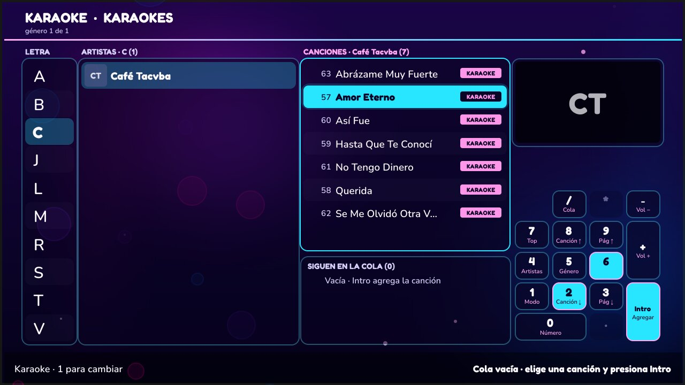
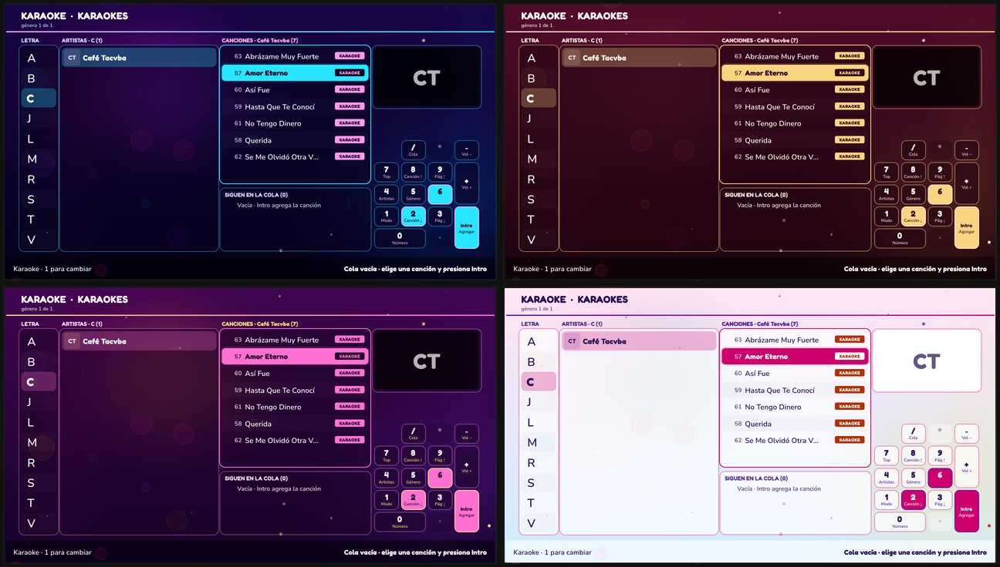
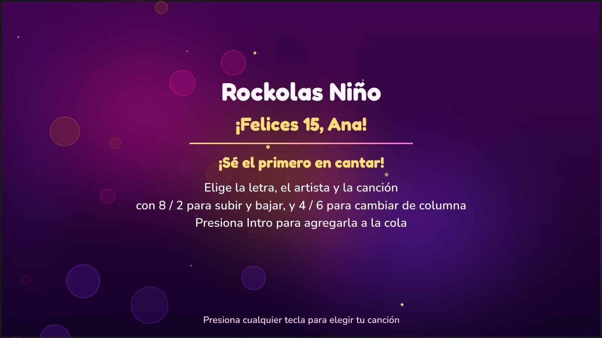

Rockola de **karaoke y música sin internet** para rentar en fiestas. Corre en
**Debian / Puppy Linux** con 2 GB de RAM, se maneja solo con el **teclado
numérico** y arranca sola en pantalla completa al encender la computadora.

## Cómo se usa

1. Al encender se ve la bienvenida y luego **¿Qué quieres hacer?**: Karaoke,
   Videos o Música.
2. Se elige **letra → artista → canción** con 8 / 2 (subir y bajar) y 4 / 6
   (cambiar de columna); **Intro** la agrega a la cola. También se puede pedir por
   **número** del catálogo impreso (tecla 0).
3. Mientras alguien canta, cualquier tecla abre la lista sin cortar la canción;
   se agrega otra y **7** (o **6** desde Canciones) regresa a cantar. Si nadie
   toca el teclado, vuelve sola a los 10 segundos.
4. Bajo las canciones se ve **la cola que sigue**, y 10 segundos antes del final
   aparece quién sigue.

| ¿Qué quieres hacer? | Música sin video: la portada en grande |
|---|---|
|  |  |

## Temas para cada evento

Moderno, boda, XV años e infantil, con fondo de luces animado (se pausa durante
los videos para no quitarle fuerza a la computadora). Se cambia desde el menú de
administrador.

## Qué tiene

- **166 mil canciones** con búsqueda instantánea; cada una con un **número fijo**.
- Reproduce **AVI, MPG, MP4, WMV, MKV, MP3, WMA, FLAC, CDG+MP3…** con volumen
  parejo, todo dentro de la misma pantalla.
- Encuentra y monta el **disco de música** solo, aunque cambie de nombre o de puerto.
- **Portadas** de los artistas (JPEG, PNG, GIF, WebP o BMP).
- Sobrevive a un apagón: volumen y ajustes se guardan; al reiniciar arranca en
  silencio y con la cola vacía.
- **Actualización por USB**, sin internet, con regreso automático a la versión
  anterior si algo falla.
- Pensado para **discos de varios TB**: escaneo incremental y en segundo plano,
  sin trabar el video.

## Documentación

| Tema | Documento |
|------|-----------|
| Cómo deben estar las carpetas | [CARPETAS.md](CARPETAS.md) |
| Instalar en la rockola y arranque automático | [AUTOSTART.md](AUTOSTART.md) |
| Agregar canciones | [AGREGAR-CANCIONES.md](AGREGAR-CANCIONES.md) |
| Operación en renta y menú de administrador | [OPERACION.md](OPERACION.md) |
| Mantenimiento | [MANTENIMIENTO.md](MANTENIMIENTO.md) |
| Audio, video y mpv sin internet | [AUDIO-VIDEO-DRIVERS.md](AUDIO-VIDEO-DRIVERS.md) |
| Compilar y desarrollar | [BUILD-DEPS.md](BUILD-DEPS.md) · [DEV-SIN-MUSICA.md](DEV-SIN-MUSICA.md) |
| Rendimiento | [PERFORMANCE.md](PERFORMANCE.md) |
| Requerimientos y estado | [REQUERIMIENTOS.md](REQUERIMIENTOS.md) |

Código: [github.com/joemag50/KaraokeNino](https://github.com/joemag50/KaraokeNino)

<small>Las capturas salen de las pruebas automáticas, con un catálogo de ejemplo y
sin disco: en la rockola, en lugar de las iniciales se ven las portadas.</small>
